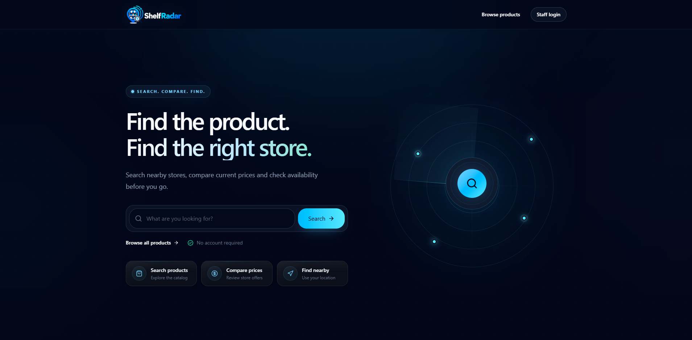
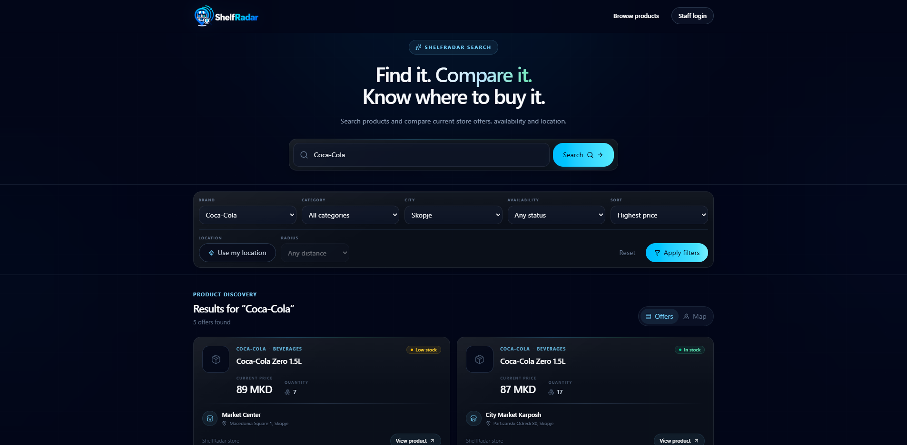
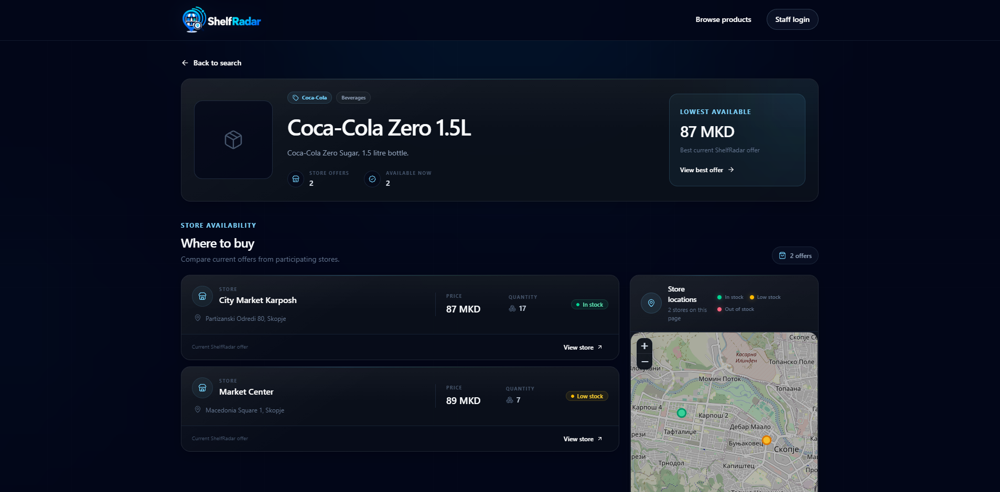
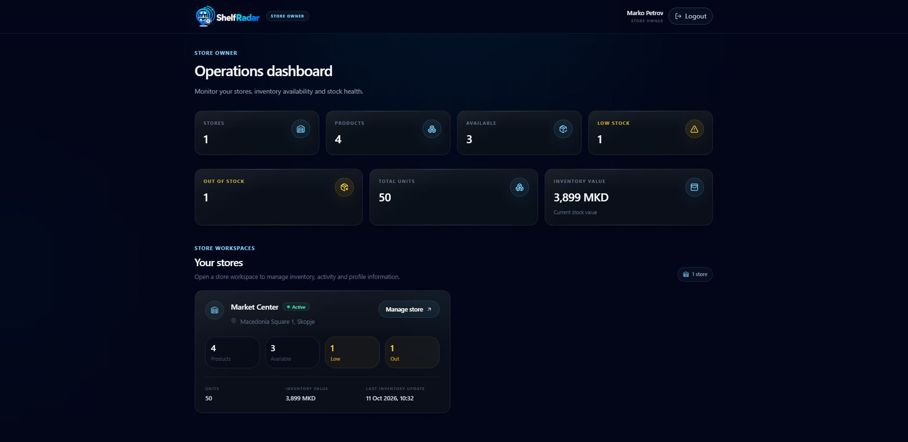
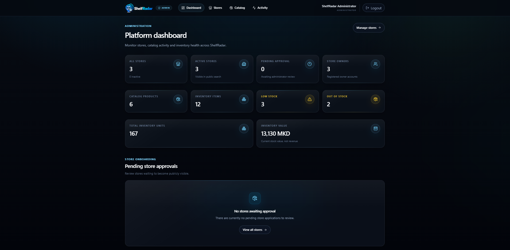
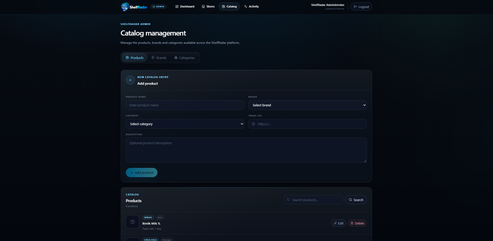

# ShelfRadar

[](https://github.com/nikolasarafimov/shelfradar/actions/workflows/ci.yml)

**Find it nearby. Compare it clearly. Know before you go.**

ShelfRadar is a full-stack product discovery and inventory management platform for finding products in nearby stores, comparing prices, checking stock availability, and exploring store locations on an interactive map.

The application combines a public search experience with dedicated management interfaces for store owners and administrators.

<p align="center">
  
</p>

---

## Features

### Public Experience

Public users can browse ShelfRadar without authentication.

They can:

- Search products across active stores
- Compare prices between stores
- Filter by brand, category, stock status, and city
- Sort by price, product name, or latest update
- Search using geographic coordinates
- Filter results within a selected radius
- Sort nearby results by distance
- View current quantity and stock status
- View detailed product pages
- View detailed store pages
- Browse store locations on interactive maps
- See calculated distance from their location

### Store Owner Portal

Authenticated users with the `STORE_OWNER` role can:

- View all stores assigned to their account
- View owner-level dashboard metrics
- View individual store dashboards
- Update store profile and location data
- Search and manage store inventory
- Add catalog products to inventory
- Update prices, quantities, and stock status
- Remove inventory items
- View low-stock and out-of-stock information
- Review store activity history

Store ownership is enforced by the backend. A store owner cannot access or modify another owner's stores by changing resource IDs.

### Administrator Portal

Authenticated users with the `ADMIN` role can:

- View platform-wide dashboard metrics
- Search and filter stores
- Inspect detailed store information
- Update store profiles
- Change store ownership
- Change store status
- Manage brands
- Manage categories
- Manage products
- Review audit records
- Search and filter platform activity
- View activity analytics
- View the most active stores
- Review recent administrative and inventory activity

---

## Screenshots

<table>
  <tr>
    <td width="50%">
      <strong>Public Product Search</strong><br><br>
      
    </td>
    <td width="50%">
      <strong>Product Details and Store Offers</strong><br><br>
      
    </td>
  </tr>
  <tr>
    <td width="50%">
      <strong>Store Owner Dashboard</strong><br><br>
      
    </td>
    <td width="50%">
      <strong>Administrator Dashboard</strong><br><br>
      
    </td>
  </tr>
  <tr>
    <td colspan="2">
      <strong>Catalog Management</strong><br><br>
      
    </td>
  </tr>
</table>

---

## Technology Stack

### Backend

- Java 21
- Spring Boot 4.1.1
- Spring Web MVC
- Spring Security
- OAuth2 Resource Server
- JWT authentication
- Spring Data JPA
- Hibernate
- Jakarta Validation
- Flyway
- PostgreSQL 16
- PostGIS
- Maven

### Frontend

- React 19
- TypeScript 6
- Vite 8
- Tailwind CSS 4
- Motion
- React Router
- TanStack Query
- Axios
- React Hook Form
- Zod
- React Leaflet
- Leaflet
- Vitest
- Testing Library

### Infrastructure

- Docker
- Docker Compose
- Nginx
- GitHub Actions
- PostgreSQL
- PostGIS

---

## Architecture

ShelfRadar follows a layered full-stack architecture.

```text
Browser
   |
   v
React SPA
   |
   | HTTP / JSON
   v
Nginx
   |
   | /api/*
   v
Spring Boot REST API
   |
   +-------------------------------+
   | Controllers                   |
   | Services                      |
   | DTOs / Validation             |
   | Mappers                       |
   | Repositories                  |
   | Security                      |
   | Audit / Analytics             |
   +-------------------------------+
   |
   v
PostgreSQL + PostGIS
```

The backend is the authority for authentication, authorization, ownership checks, validation, and data integrity.

The frontend is separated into public, store-owner, and administrator experiences.

---

## Project Structure

```text
shelfradar/
├── .github/
│   └── workflows/
│       └── ci.yml
│
├── backend/
│   ├── src/
│   │   ├── main/
│   │   │   ├── java/com/shelfradar/backend/
│   │   │   │   ├── config/
│   │   │   │   ├── controller/
│   │   │   │   ├── dto/
│   │   │   │   ├── entity/
│   │   │   │   ├── exception/
│   │   │   │   ├── mapper/
│   │   │   │   ├── repository/
│   │   │   │   ├── security/
│   │   │   │   └── service/
│   │   │   └── resources/
│   │   │       ├── db/migration/
│   │   │       └── application.yml
│   │   └── test/
│   ├── Dockerfile
│   └── pom.xml
│
├── docs/
│   └── screenshots/
│       ├── admin-catalog.png
│       ├── admin-dashboard.png
│       ├── home.png
│       ├── public-product.png
│       ├── public-search.png
│       └── store-dashboard.png
│
├── frontend/
│   ├── src/
│   │   ├── api/
│   │   ├── components/
│   │   ├── features/
│   │   ├── lib/
│   │   ├── pages/
│   │   ├── test/
│   │   └── types/
│   ├── Dockerfile
│   ├── nginx.conf
│   ├── package.json
│   └── vite.config.ts
│
├── http/
│   ├── admin-stores.http
│   ├── audit.http
│   ├── auth.http
│   ├── catalog.http
│   ├── health.http
│   ├── nearby-search.http
│   ├── public-browse.http
│   ├── public-search.http
│   ├── store-dashboard.http
│   └── store.http
│
├── .env.example
├── .gitignore
├── docker-compose.yml
└── README.md
```

---

## Domain Model

The core domain consists of users, products, brands, categories, stores, inventory records, and audit events.

### Users

Authenticated users have one of two roles:

```text
ADMIN
STORE_OWNER
```

### Stores

A store contains:

- Name
- Address
- City
- Latitude and longitude
- Phone
- Working hours
- Owner
- Status
- Creation timestamp

Supported store statuses:

```text
PENDING
ACTIVE
INACTIVE
```

Only active stores are exposed through the public browsing API.

### Products

Products contain:

- Name
- Description
- Image URL
- Brand
- Category
- Creation timestamp

### Inventory

Inventory connects a product with a store and contains:

- Product
- Store
- Price
- Quantity
- Stock status
- Last update timestamp

Supported stock statuses:

```text
IN_STOCK
LOW_STOCK
OUT_OF_STOCK
```

A store can contain a given product only once.

Inventory state consistency is also enforced:

```text
quantity = 0
→ status must be OUT_OF_STOCK

quantity > 0
→ status cannot be OUT_OF_STOCK
```

### Audit Log

Important administrative and store-owner actions are recorded with information such as:

- Actor
- Actor role
- Action
- Entity type
- Entity ID
- Store snapshot
- Product snapshot
- Change details
- Timestamp

---

## Geographic Search

ShelfRadar uses PostGIS for location-aware product discovery.

Public search supports:

- Latitude and longitude
- Radius filtering
- Distance calculation
- Distance-based sorting

Relevant PostGIS operations include:

```text
ST_MakePoint
ST_SetSRID
ST_Distance
ST_DWithin
```

Distance values are returned by the API in kilometers.

Geographic queries are performed in the database instead of loading all stores into application memory and calculating distances in JavaScript or Java.

---

## Authentication and Authorization

ShelfRadar uses stateless JWT authentication.

```text
Email + Password
      |
      v
Spring AuthenticationManager
      |
      v
JWT issued by backend
      |
      v
Frontend stores the token in sessionStorage
      |
      v
Authorization: Bearer <token>
      |
      v
Spring Security validates the JWT
```

JWTs use HS256 signing and include authentication information such as the subject, user ID, role, issuer, issue time, and expiration time.

No server-side HTTP session is required.

### Access Rules

Public endpoints:

```text
/api/health
/api/auth/login
/api/public/**
```

Store-owner endpoints:

```text
/api/store/**
```

Required role:

```text
STORE_OWNER
```

Administrator endpoints:

```text
/api/admin/**
```

Required role:

```text
ADMIN
```

Authentication failures return `401 Unauthorized`.

Authenticated users without the required role receive `403 Forbidden`.

Ownership violations for store-owner resources are handled using owner-scoped resource access.

---

## API Overview

### Health

```http
GET /api/health
```

Checks application, database, and PostGIS availability.

### Authentication

```http
POST /api/auth/login
GET  /api/auth/me
```

### Public Search

```http
GET /api/public/search
GET /api/public/filters
```

Supported search parameters include:

```text
q
brandId
categoryId
status
city
page
size
sort
latitude
longitude
radiusKm
```

Supported search modes include standard filtering, price sorting, alphabetical sorting, recently updated sorting, radius filtering, and distance sorting.

### Public Browsing

```http
GET /api/public/products/{productId}
GET /api/public/stores/{storeId}
```

Product details include offers from active stores.

Store details are publicly accessible only for active stores.

### Store Owner

```http
GET /api/store/dashboard

GET /api/store/stores
GET /api/store/stores/{storeId}
PUT /api/store/stores/{storeId}

GET    /api/store/stores/{storeId}/inventory
POST   /api/store/stores/{storeId}/inventory
PUT    /api/store/stores/{storeId}/inventory/{inventoryId}
DELETE /api/store/stores/{storeId}/inventory/{inventoryId}

GET /api/store/stores/{storeId}/dashboard
GET /api/store/stores/{storeId}/activity

GET /api/store/catalog/products
```

### Administrator

```http
GET /api/admin/dashboard

GET   /api/admin/stores
GET   /api/admin/stores/filters
GET   /api/admin/stores/{storeId}
PUT   /api/admin/stores/{storeId}
PATCH /api/admin/stores/{storeId}/status

GET /api/admin/store-owners

GET /api/admin/analytics
GET /api/admin/audit
```

### Catalog Administration

Brands:

```http
GET    /api/admin/catalog/brands
GET    /api/admin/catalog/brands/{id}
POST   /api/admin/catalog/brands
PUT    /api/admin/catalog/brands/{id}
DELETE /api/admin/catalog/brands/{id}
```

Categories:

```http
GET    /api/admin/catalog/categories
GET    /api/admin/catalog/categories/{id}
POST   /api/admin/catalog/categories
PUT    /api/admin/catalog/categories/{id}
DELETE /api/admin/catalog/categories/{id}
```

Products:

```http
GET    /api/admin/catalog/products
GET    /api/admin/catalog/products/{id}
POST   /api/admin/catalog/products
PUT    /api/admin/catalog/products/{id}
DELETE /api/admin/catalog/products/{id}
```

---

## Validation and Error Handling

ShelfRadar validates requests at both the API and domain levels.

Examples include:

- Required names and identifiers
- Positive resource IDs
- Maximum field lengths
- Non-negative prices
- Non-negative quantities
- Latitude between `-90` and `90`
- Longitude between `-180` and `180`
- Valid pagination values
- Valid inventory state combinations
- Valid geographic search combinations

For nearby search:

- Latitude and longitude must be supplied together
- Radius requires a location
- Radius must be greater than `0` and at most `100 km`
- Distance sorting requires a location

The backend provides centralized REST exception handling.

Typical responses include:

```text
400 Bad Request
401 Unauthorized
403 Forbidden
404 Not Found
409 Conflict
```

Validation errors use a structured response similar to:

```json
{
  "timestamp": "2026-01-01T12:00:00Z",
  "status": 400,
  "error": "Bad Request",
  "message": "Validation failed.",
  "path": "/api/example",
  "fieldErrors": {
    "field": "Invalid value."
  }
}
```

---

## Database Migrations

Database schema evolution is managed by Flyway.

Migrations are stored in:

```text
backend/src/main/resources/db/migration
```

They manage:

- PostgreSQL schema objects
- PostGIS support
- Users
- Brands
- Categories
- Products
- Stores
- Inventory
- Constraints
- Search indexes
- Geographic indexes
- Audit logs
- Development seed data

Hibernate uses schema validation rather than automatic schema generation:

```yaml
ddl-auto: validate
```

Flyway remains the source of truth for database changes.

---

## Frontend

The frontend is a React single-page application with separate experiences for public users, store owners, and administrators.

The UI includes:

- Responsive desktop and mobile layouts
- Dark visual design
- Search and filter interfaces
- Interactive maps
- Dashboard metrics
- Inventory management
- Store management
- Catalog administration
- Audit and analytics views
- Loading states
- Empty states
- Error states
- Accessible controls
- Reduced-motion support

Routes are code-split using lazy loading to reduce the initial application bundle.

---

## Interactive Maps

Maps use Leaflet and React Leaflet with OpenStreetMap tiles.

ShelfRadar supports:

- Search result markers
- Individual store maps
- User-location markers
- Automatic map bounds
- Multiple stores on a single map
- Distance-aware search results

---

# Running the Application

## Docker Compose

Docker Compose is the recommended way to run the complete application.

### Requirements

Install:

- Docker
- Docker Compose

### 1. Configure the Environment

Create a local `.env` file from the provided template.

Linux/macOS:

```bash
cp .env.example .env
```

Windows PowerShell:

```powershell
Copy-Item .env.example .env
```

Set a development JWT secret:

```env
JWT_SECRET=replace-with-a-long-random-development-secret
```

The real `.env` file is ignored by Git and must not be committed.

### 2. Start ShelfRadar

From the repository root:

```bash
docker compose up --build
```

Docker Compose starts:

```text
PostgreSQL + PostGIS
Spring Boot backend
React/Nginx frontend
```

### 3. Open the Application

Frontend:

```text
http://localhost:3000
```

Backend API:

```text
http://localhost:8080
```

Health endpoint:

```text
http://localhost:8080/api/health
```

The frontend Nginx container proxies `/api/*` requests to the backend container.

---

## Docker Services

The Compose stack contains three services:

```text
shelfradar-db
shelfradar-backend
shelfradar-frontend
```

The database uses:

```text
postgis/postgis:16-3.4
```

PostgreSQL data is persisted in:

```text
shelfradar_db_data
```

Stop the stack without removing database data:

```bash
docker compose down
```

Reset the database completely:

```bash
docker compose down -v
```

The second command removes the database volume and should only be used when a full reset is intended.

---

## Local Development

### Database

When running outside Docker, PostgreSQL 16 with PostGIS must be available.

Default development settings:

```text
Database: shelfradar
Username: shelfradar
Password: shelfradar
Host: localhost
Port: 5432
```

### Backend

Navigate to:

```bash
cd backend
```

Set the JWT secret in your environment and start Spring Boot.

Windows PowerShell:

```powershell
$env:SECURITY_JWT_SECRET="replace-with-a-long-random-development-secret"
.\mvnw.cmd spring-boot:run
```

Linux/macOS:

```bash
export SECURITY_JWT_SECRET="replace-with-a-long-random-development-secret"
./mvnw spring-boot:run
```

Backend:

```text
http://localhost:8080
```

### Frontend

Navigate to:

```bash
cd frontend
```

Install dependencies:

```bash
npm ci
```

Start Vite:

```bash
npm run dev
```

Frontend development server:

```text
http://localhost:5173
```

During development, `/api` requests are proxied to the backend.

---

## Environment Variables

### Docker Compose

The root `.env` file provides:

```text
JWT_SECRET
```

Docker Compose maps it to:

```text
SECURITY_JWT_SECRET
```

### Spring Boot

Backend configuration can also be supplied directly with:

```text
SPRING_DATASOURCE_URL
SPRING_DATASOURCE_USERNAME
SPRING_DATASOURCE_PASSWORD

SECURITY_JWT_ISSUER
SECURITY_JWT_EXPIRATION_MINUTES
SECURITY_JWT_SECRET
```

Production deployments must use separate, strong credentials and secrets.

---

## Development Accounts

The development seed data includes local demonstration accounts used by the HTTP request collection.

### Administrator

```text
Email:    admin@shelfradar.local
Password: Admin123!
```

### Store Owner

```text
Email:    marko@shelfradar.local
Password: Store123!
```

These credentials are development-only and must not be reused in production.

---

## HTTP Request Collection

The `http/` directory contains IntelliJ HTTP Client requests covering the major API flows:

```text
auth.http
health.http
catalog.http
store.http
store-dashboard.http
admin-stores.http
audit.http
public-browse.http
public-search.http
nearby-search.http
```

The collection covers authentication, authorization, catalog CRUD, inventory management, ownership protection, dashboards, audit activity, public browsing, search, validation, and PostGIS-based nearby search.

---

## Verification

### Backend

Run backend tests and the complete Maven verification lifecycle.

Windows:

```powershell
cd backend
.\mvnw.cmd clean verify
```

Linux/macOS:

```bash
cd backend
./mvnw clean verify
```

### Frontend

From `frontend/`:

```bash
npm ci
npm run check
```

The frontend verification command runs:

```text
ESLint
Vitest
TypeScript compilation
Vite production build
```

Individual commands are also available:

```bash
npm run lint
npm run test
npm run build
```

### Docker

From the project root:

```bash
docker compose config
docker compose build
docker compose up
```

Then verify:

```text
http://localhost:3000
http://localhost:8080/api/health
```

---

## Continuous Integration

ShelfRadar uses GitHub Actions for continuous integration.

The CI workflow runs automatically on:

```text
Pushes to main
Pull requests targeting main
Manual workflow dispatch
```

The workflow contains three jobs:

### Backend

```text
Java 21
Maven dependency cache
./mvnw -B clean verify
```

### Frontend

```text
Node.js 22
npm ci
npm run check
```

### Docker

Runs after the backend and frontend jobs succeed:

```text
docker compose config
docker compose build
```

The CI badge at the top of this README reflects the current workflow status on the `main` branch.

---

## Security

ShelfRadar includes:

- BCrypt password hashing
- Stateless JWT authentication
- JWT expiration
- JWT issuer validation
- HS256 signature verification
- Backend role-based authorization
- Owner-scoped store access
- Request validation
- Database constraints
- Unique inventory constraints
- Centralized REST error handling
- Protected administrator endpoints
- Protected store-owner endpoints

Frontend route protection is provided for user experience, but authorization decisions remain enforced by the backend.

---

## Store Ownership Protection

A store owner cannot access another owner's store by changing a URL or resource ID.

Backend services verify ownership using the authenticated user's identity before allowing:

- Store access
- Store updates
- Inventory reads
- Inventory creation
- Inventory updates
- Inventory deletion
- Dashboard access
- Activity access

---

## Inventory Consistency

ShelfRadar maintains consistency between inventory quantity and stock status.

For example:

```text
quantity = 0
```

requires:

```text
OUT_OF_STOCK
```

while a positive quantity cannot use:

```text
OUT_OF_STOCK
```

These rules are validated before persistence, with database constraints providing additional integrity protection.

---

## Audit and Analytics

ShelfRadar records important changes such as:

- Inventory creation
- Inventory updates
- Inventory deletion
- Store profile updates
- Store status changes
- Store owner changes
- Product changes
- Brand changes
- Category changes

Administrator analytics include:

- Activity during the last 24 hours
- Activity during the last 7 days
- Inventory changes
- Store changes
- Daily activity
- Most active stores
- Recent activity

Store owners can inspect activity associated with stores they own.

---

## Design Goals

ShelfRadar was built around several engineering principles:

**Backend-enforced security**  
Authentication, role authorization, and resource ownership are enforced by Spring Security and service-level checks.

**Data integrity**  
Jakarta Validation, domain validation, database constraints, and transactional services protect persisted data.

**Clear separation of concerns**  
Controllers, DTOs, services, mappers, repositories, security components, and persistence entities have distinct responsibilities.

**Geographic search in the database**  
PostGIS handles radius and distance queries instead of transferring geographic datasets to application code.

**Versioned schema management**  
Flyway owns database evolution while Hibernate validates the resulting schema.

**Reproducible local environment**  
Docker Compose provides the same database, backend, and frontend topology with one command.

**Continuous verification**  
GitHub Actions verifies the backend, frontend, and Docker build on changes to the main development branch.

**Responsive user experience**  
The frontend supports desktop and mobile layouts, interactive maps, meaningful application states, and reduced-motion preferences.

---

## Production Considerations

Before a production deployment:

- Replace all development credentials
- Generate a strong JWT secret
- Configure secure database credentials
- Use HTTPS
- Configure production DNS
- Configure backups
- Configure monitoring and logging
- Review CORS requirements when frontend and API use different origins
- Verify Flyway migrations
- Run backend verification
- Run frontend verification
- Build all Docker images
- Perform end-to-end smoke testing

---

## License

No open-source license is currently included with this repository.

---

## ShelfRadar

**Find it nearby. Compare it clearly. Know before you go.**

---

## Author

Nikola Sarafimov